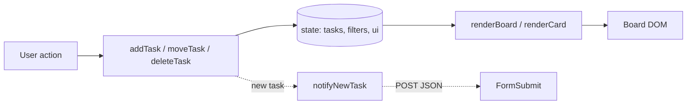

# kanban10 — IT PMO Kanban Board


An internal demo/training Kanban board for a fictitious bank's IT PMO. One file, no build step, no framework.

**Live demo:** https://siva28112.github.io/kanban10/

## Features
- Four columns (Backlog, In Progress, Blocked, Done) with live count badges
- Drag-and-drop plus a keyboard "Move" fallback
- Add Task form with inline validation; inline delete confirmation
- Filters by project, assignee and priority; live summary strip; overdue badges
- Email notification for new tasks via FormSubmit

## Architecture
Everything lives in `index.html` (markup, `<style>`, `<script>`).



- State-driven rendering: mutate `state`, then `renderBoard()` rebuilds the DOM.
- Board events are delegated on `#board`.
- Submit is optimistic; a failed notification only shows a warning toast.
- No persistence: a refresh resets to seeded data.

## Install / run
```bash
git clone https://github.com/siva28112/kanban10.git
cd kanban10
open index.html            # or: python3 -m http.server 8765
```
To receive notifications, set `FORMSUBMIT_ENDPOINT` at the top of the script to your own address, then submit one task and click the one-time activation link FormSubmit emails you. Don't commit a real address.

## Constraints
No `localStorage`/`sessionStorage`/IndexedDB/cookies, no external resources, neutral branding. Persistence would need a backend and database with load-on-init and write-through on add/move/delete.
